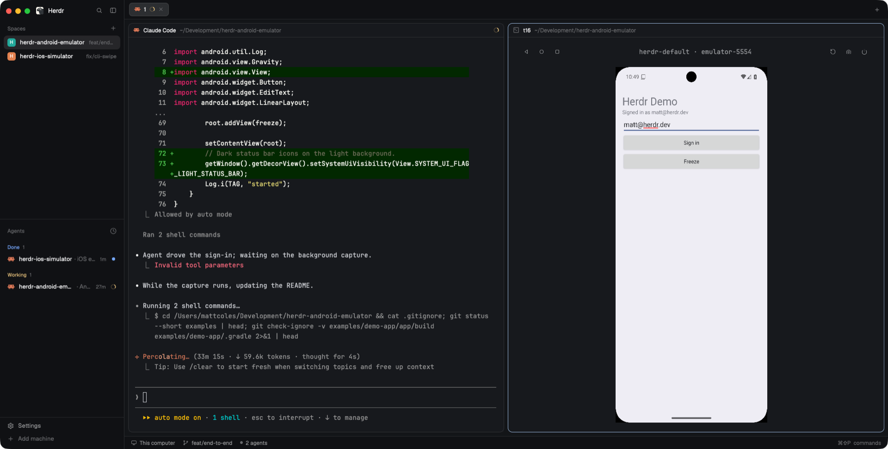
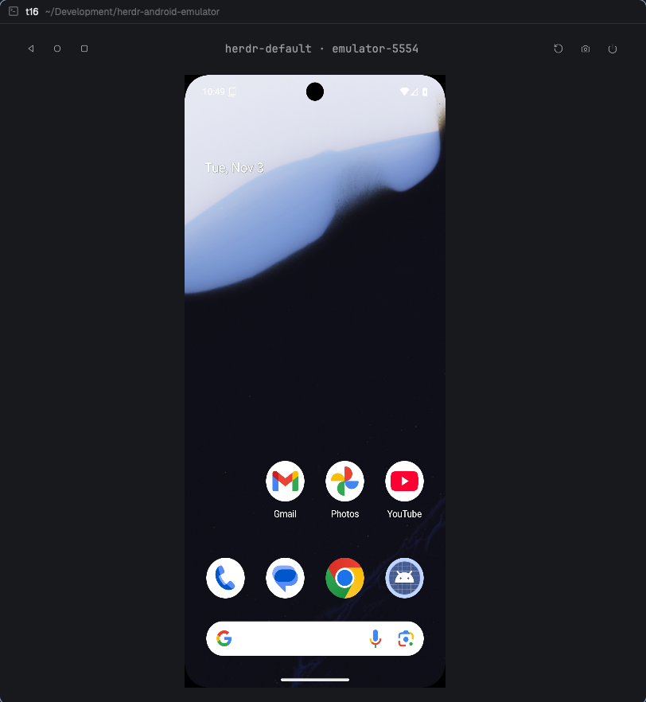

# herdr-android-emulator

An Android emulator inside [herdr](https://herdr.dev). The emulator opens in a view next to your coding agent, so you and your agent use the same device, and the agent can read every log, crash and event the app produces. Its sibling, [herdr-ios-simulator](https://github.com/MattJColes/herdr-ios-simulator), does the same for iOS with the same commands.



> **Status: early development.** The View, the agent CLI, logs, crashes and events work on macOS; Linux is untested. [docs/FEATURES.md](docs/FEATURES.md) lists what's built and what's next.

## What it does

### A view beside your agent

Run **Android: open** from herdr, pick **Android** from herdr desktop's + menu, or let the agent run `herdr-android boot --show`. The emulator boots without its own window and appears in a herdr pane. Click to tap, drag to swipe, type to type. The header has Android's Back, Home and Recents buttons on the left, and Rotate, Send screenshot to agent and Power on the right; hover one to see its name.



### Set up in one command

`herdr-android install-sdk` installs the Android SDK, a system image and a ready-to-boot device. No Android Studio.

### Agents build, run and drive the app

The agent builds with Gradle and gets back only the errors and warnings, with file:line. It installs and launches the app, lists what's on screen, and taps and types like you would. You watch it happen and can take over at any point.

### Every log and event, on demand

`logs` returns the app's logcat, following it across restarts. `crashes` returns crashes and ANRs with their stacks, even from before the last reboot:

```
$ herdr-android crashes
22:49:46 boot 11 crash in dev.herdr.demo
  java.lang.IllegalStateException: sign in failed: no email
    at dev.herdr.demo.MainActivity.lambda$onCreate$1(MainActivity.java:53)
    at android.view.View.performClick(View.java:8083)
```
`events` returns the device's timeline: boots, installs, launches, and your taps in the view. Nothing streams into the agent's context until it asks.

## Requirements

1. [herdr](https://herdr.dev) 0.9.0 or later.
2. macOS or Linux. On Linux, KVM (`/dev/kvm`) for a usable emulator speed.
3. JDK 17 or later, for the Android SDK tools.
4. Rust (`cargo`), because herdr builds the plugin from source when it installs.
5. `curl` and `unzip`, which `install-sdk` uses to download the SDK.
6. About 10 GB of free disk for the SDK, a system image and a device, which grows as you use it.
7. `~/.local/bin` on your `PATH`, where the `herdr-android` command is linked.
8. To build and run your own app, a Gradle Android project.

The view is sharpest in herdr desktop, or the herdr TUI in Ghostty, kitty or WezTerm. Other terminals get a lower-resolution picture.

The Android SDK itself comes from `herdr-android install-sdk`, or uses the one in `ANDROID_HOME` if you have it. Without `herdr-default`, it boots the AVD you used most recently, such as one from Android Studio. Booting an AVD sets `hw.keyboard=yes` in its `config.ini`, because the emulator ignores the View's typing and keys without a hardware keyboard.

## Install

```sh
herdr plugin install MattJColes/herdr-android-emulator
herdr-android install-sdk      # skip if you already have the SDK and an AVD
herdr-android install-agents   # teach Claude Code, Codex, OpenCode and Pi to use it
```

herdr shows the commands the plugin will run, builds it with `cargo build --release`, and links `herdr-android` into `~/.local/bin` the next time herdr starts. To link it straight away:

```sh
herdr plugin action invoke herdr-android-emulator.install-cli
```

## Update

```sh
herdr plugin update herdr-android-emulator
herdr-android install-agents   # refresh what your agents know about new commands
```

This fetches the latest commit and rebuilds. A running device keeps running, and a view that is already open keeps the old build; close it and open it again to get the new one.

## Uninstall

```sh
herdr-android uninstall
herdr plugin uninstall herdr-android-emulator
```

Run `herdr-android uninstall` first: it removes the `herdr-android` link and the section `install-agents` added to your agents' instruction files. `herdr plugin uninstall` then unregisters the plugin, but leaves its settings and recorded logs in place. To remove those too:

```sh
rm -rf ~/.local/state/herdr/plugins/herdr-android-emulator
rm -rf ~/.config/herdr/plugins/config/herdr-android-emulator
```

The Android SDK and your virtual devices stay, because Android Studio, Flutter and React Native use the same ones. To remove them too:

```sh
rm -rf ~/Library/Android/sdk ~/.android/avd   # macOS
rm -rf ~/Android/Sdk ~/.android/avd           # Linux
```

## For agents

```sh
herdr-android boot --show                    # boot the default device and show it to the user
herdr-android build --run                    # errors/warnings with file:line, then install and launch
herdr-android ui                             # [4] Button "Sign in"
herdr-android tap 4
herdr-android type "hello" --submit
herdr-android mark before-login
herdr-android logs --errors --since before-login
herdr-android crashes
herdr-android screenshot /tmp/screen.png
```

`herdr-android agent-help` prints the full list. Add `--json` to any command for structured output, and `--device emulator-5556` to pick a device when several are running.

## Using the view

| Input | What it does |
|---|---|
| Click | Tap |
| Drag | Swipe |
| Scroll wheel | Scroll |
| Typing, Return, Backspace, Tab | Sent to the focused field |
| Ctrl-B | Back |
| Ctrl-O | Home |
| Ctrl-X | Send a screenshot to the agent |
| Ctrl-Q | Close the view (the device keeps running) |
| Header buttons | Back, Home, Recents · Rotate, Send screenshot to agent, Power (shuts the device down) |

## Settings

Optional. Put them in `~/.config/herdr/plugins/config/herdr-android-emulator/config.toml`:

```toml
default_device = "herdr-default"   # the AVD `boot` and the view use when nothing is running; unset: herdr-default, else your most recently used AVD
fps = 15                           # live view frame rate, 1-30
view_renderer = "blocks"           # if the view stays blank in your terminal
cell_aspect = 2.6                  # if the device looks stretched
```

## Try it

`examples/demo-app` is a sign-in screen with two bugs to find: Sign in with no email crashes, and Freeze causes an ANR.

```sh
cd examples/demo-app
herdr-android boot --show
herdr-android build --run
```

## Troubleshooting

| Problem | Fix |
|---|---|
| `herdr-android: command not found` | Add `~/.local/bin` to your `PATH`, or run `herdr plugin action invoke herdr-android-emulator.install-cli`. |
| `no AVD named …` | `herdr-android devices` lists your AVDs; boot one by name, set `default_device`, or run `herdr-android install-sdk`. |
| The view is blank | Set `view_renderer = "blocks"`. |
| The device looks stretched | Set `cell_aspect`, e.g. `2.6`. |
| Typing in the view does nothing | Shut the device down (the Power button) and boot it again, so it picks up its hardware keyboard. |
| The emulator is very slow on Linux | Enable KVM: `/dev/kvm` must exist and be readable by you. |
| `install-sdk` can't find Java | Install JDK 17 or later, or point `JAVA_HOME` at one. |

## Development

```sh
git clone git@github.com:MattJColes/herdr-android-emulator.git
cd herdr-android-emulator
cargo build --release
herdr plugin link .
git config core.hooksPath .githooks   # once per clone: fmt, clippy and tests before each commit
```

`herdr plugin link` doesn't run build commands, so rebuild with `cargo build --release` after each change. CI runs `cargo fmt`, `clippy` and the tests on macOS and Linux for every pull request. Release Please opens a release PR from Conventional Commits. Words like Device, View and Current app are defined in [GLOSSARY.md](GLOSSARY.md); decisions are in [docs/adr](docs/adr).

## License

MIT. See [LICENSE](LICENSE).
